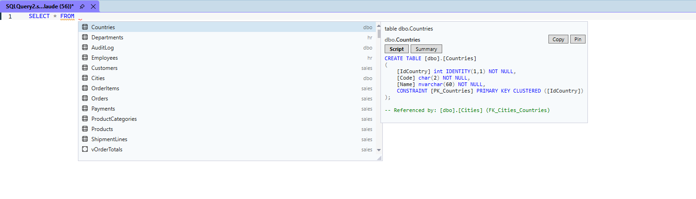
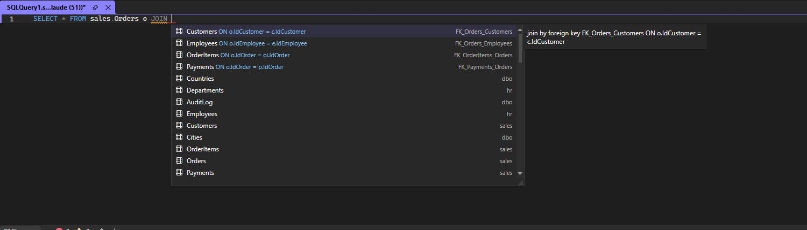
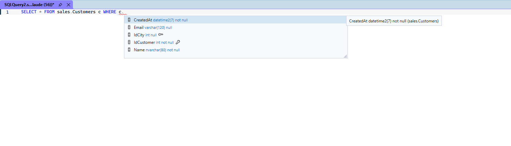
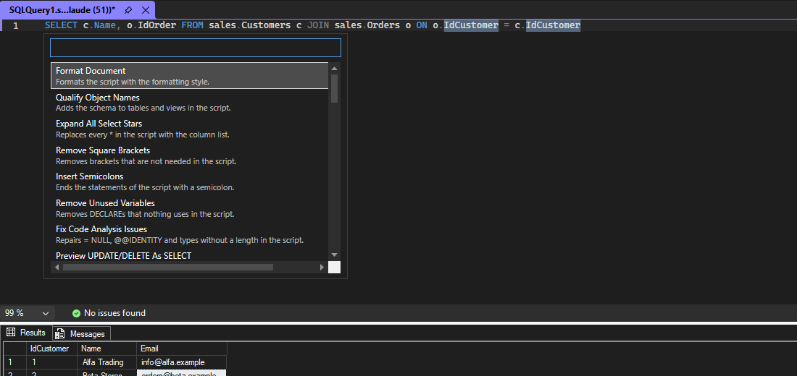
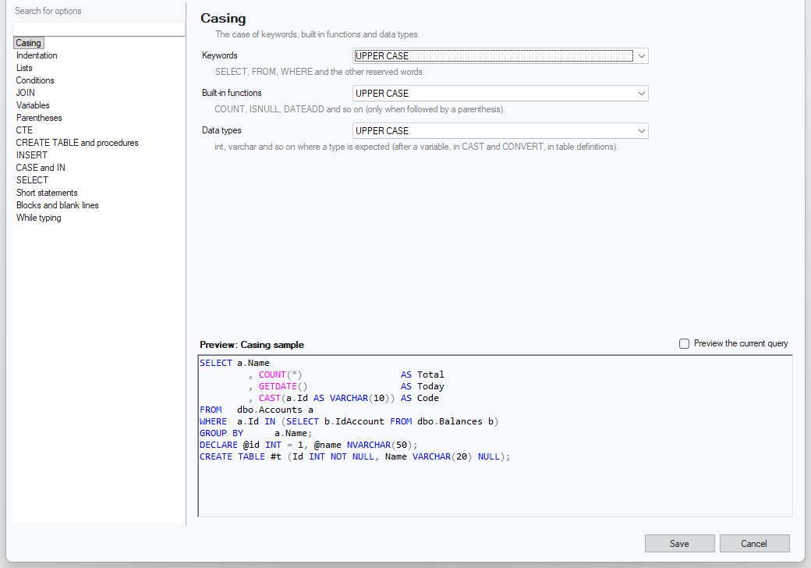
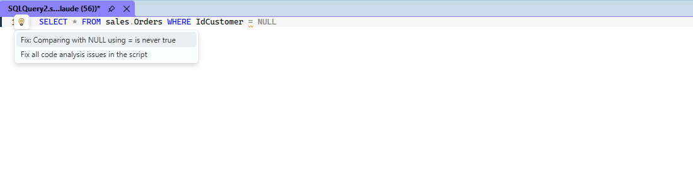
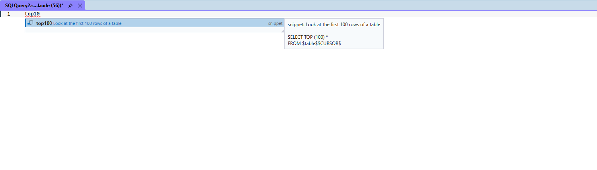
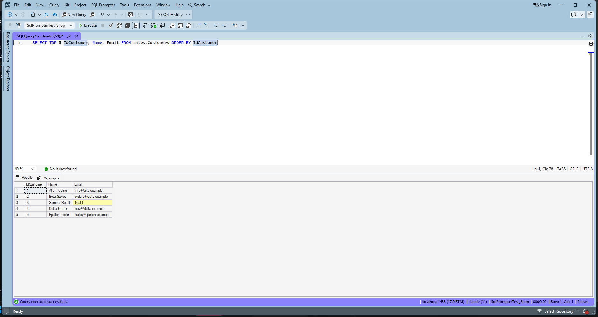
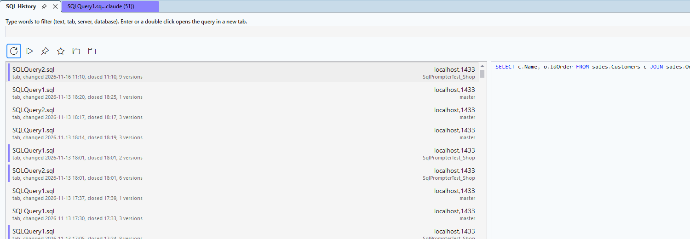
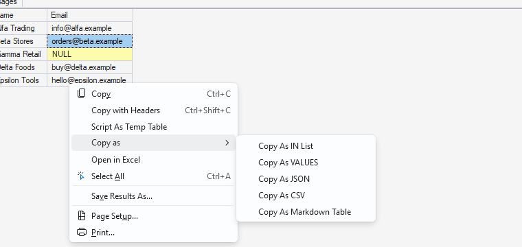

# SQL Prompter

**Smarter SQL editing for SQL Server Management Studio 22.**

Type a few letters and get the right table, column, join or procedure, formatted code and quick fixes, right in the query editor you already use. SQL Prompter is a free extension for SSMS 22 that works from what your database knows about itself: the list of tables, columns, keys and parameters, read in the background so typing never waits.

[Download](https://github.com/lenochod86/SQL-Prompter/releases) · [Help](docs/help/index.html) · [Build from source](docs/development.md)

## What you get

| Feature | Preview |
|---|---|
| **Suggestions that know your database.** One list for the whole script: tables, views, columns, functions, procedures, keywords and parameters, matched loosely and ranked by what you use most. Tab inserts the choice. |  |
| **Joins without typing the condition.** After `JOIN`, the tables linked by a foreign key come first, with the whole `ON` clause ready. |  |
| **Aliases, INSERT and EXEC done for you.** A table gets a short alias, `INSERT INTO` gets its column list, `EXEC` gets its parameters, and `*` expands to the columns on Tab. |  |
| **Quick actions.** Tap Ctrl to open one popup with formatting, refactorings, quick open, find in database code and more. |  |
| **Formatting your way.** Format a document or a selection with named styles and a live preview. |  |
| **Code analysis and quick fixes.** Squiggles for suspicious code, with one-click fixes. |  |
| **Snippets.** Short prefixes that expand into your own templates with fields; compatible with the snippet files of SQL Prompt. |  |
| **Colors for safety.** Tabs and the status bar change color by server and database, and risky changes ask for a confirmation first. |  |
| **History.** Every query you run is kept; closed tabs can be reopened and restored after a restart. |  |
| **Handy tools.** Run one statement, dry run with a rollback, copy the results grid as CSV, JSON or Markdown, open it in Excel. |  |

Everything follows the theme of SSMS, light or dark.

## Install

1. Download `SqlPrompter.Ssms.vsix` from the [latest release](https://github.com/lenochod86/SQL-Prompter/releases).
2. Close SSMS and double-click the file.
3. Start SSMS, open a query window and start typing. The **SQL Prompter** menu is under **Extensions**.

SQL Prompter checks once a day for a new version and offers to update; this is the only network access and it can be turned off in the settings.

## Your data stays yours

SQL Prompter only **reads** the structure of your database (table and column names, keys, parameters), never your data. Settings, snippets and history stay on your computer, there is no telemetry, and passwords and script text are never written to the log.

## Learn more

- [User help](docs/help/index.html): what each feature does, the settings and the keys. It is also in SSMS under **SQL Prompter > Help > Documentation**.
- [Development notes](docs/development.md): how to build and test it.
- [Architecture](docs/architecture.md): how it works and what was learned about SSMS.
- [Issues](https://github.com/lenochod86/SQL-Prompter/issues): the plan, bugs and ideas. Reports and suggestions are welcome.

## License

SQL Prompter is released under the MIT license with the Commons Clause (see [LICENSE](LICENSE)): you may use, modify and share it, but not sell it.
